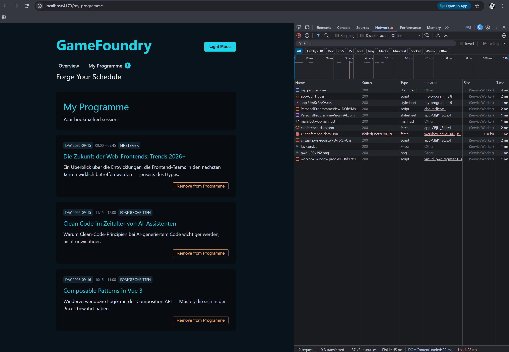
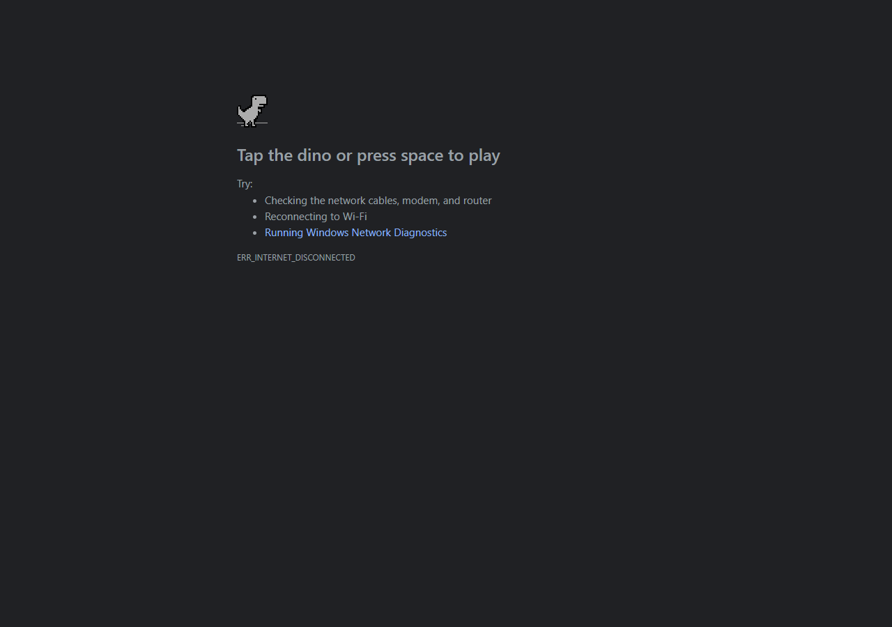
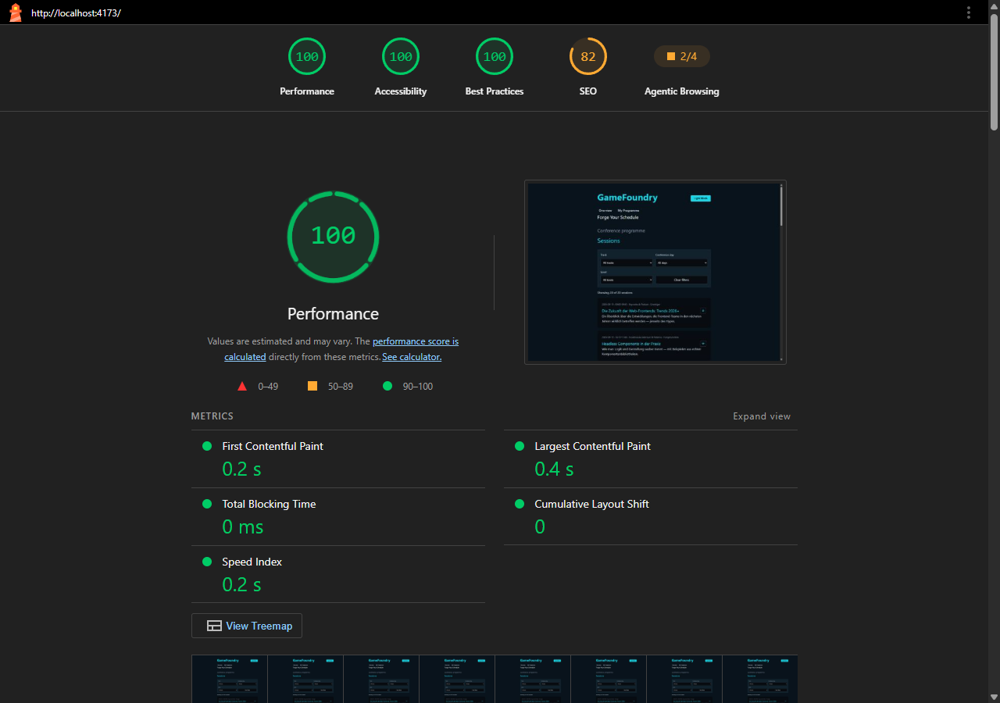

# Schritt 3 — Verifikationsnachweis (Offline-Tests & PWA-Audit)

* **Verantwortlich:** Georg Richter (Person 2, Aufgabe E)
* **Teststand:** Produktions-Build (`npm run build` → `vite-ssg` + `PWA v2.0.0`, 62 Precache-Manifest-Einträge / 56 eindeutige Cache-URLs) auf `http://localhost:4173` (`npx vite preview --port 4173 --strictPort`)
* **Testumgebung:** Windows 11, Google Chrome 157 (`Chrome/157.0.8103.51`), `lighthouse@13.6.0` (Desktop-Preset), Chrome DevTools (Network-Tab „Offline“) sowie Chrome DevTools Protocol (CDP)

---

## 1. Übersicht der durchgeführten Prüfungen

| Prüfpunkt | Geprüfte Route / Ziel | Beobachtetes Verhalten & Status | Nachweis |
| :--- | :--- | :--- | :--- |
| **Service Worker Aktivierung** | `/` (online) | `sw.js` registriert (`activated`, kontrolliert die Seite); Precache `workbox-precache-v2` speichert 56 eindeutige Ressourcen (`index.html`, 39 SSG-Routen, JS/CSS-Chunks, Icons, Manifest). | [Szenario 1](./assets/szenario-1-overview-offline.png) |
| **Szenario 1: Offline-Übersicht** | `/` (DevTools: `Offline`) | Reload liefert alle 8 Ressourcen mit HTTP `200 (ServiceWorker)` (`0 B` übertragen, `169 kB` Ressourcen, Load `43 ms`). Alle 20 Sessions werden angezeigt; Track-Filter (`frontend-architecture`) reduziert offline auf 4 Sessions. | [Szenario 1](./assets/szenario-1-overview-offline.png) |
| **SWR-Daten-Cache (B.2)** | `/sessions/s01` (`/conference-data.json`) | Erstbesuch von `/sessions/s01` löst `fetch('/conference-data.json')` aus und befüllt `conference-data-cache` (`200`). Folgeaufruf liefert sofort `200 (from ServiceWorker)` und aktualisiert den Cache-Eintrag (`Date`-Header: `09:17:53` → `09:17:56 GMT`) im Hintergrund. | Testprotokoll Abschnitt 2 |
| **Szenario 2: „Mein Programm“ offline** | `/my-programme` (DevTools: `Offline`) | Nach Vormerken von `s01`, `s05`, `s12` (`localStorage`: `["s01","s05","s12"]`) und Online-Besuch laden `/my-programme` (App-Shell-Fallback), `PersonalProgrammeView` und `/conference-data.json` offline mit `200 (ServiceWorker)` (`0 B` übertragen; Hintergrund-SWR erwartungsgemäß `ERR_INTERNET_DISCONNECTED`). Badge zeigt `3`; Offline-Entfernen aktualisiert DOM und `localStorage` sofort auf `2` (`["s05","s12"]`). | [Szenario 2](./assets/szenario-2-my-programme-offline.png) |
| **Direktsprung `/` → `/my-programme` offline** | `/my-programme` (vorher nur `/` besucht) | Auch ohne vorherigen Online-Aufruf von `/my-programme` lädt die Route offline über `navigateFallback: 'index.html'`, während `useConferenceData()` auf den eingebetteten JS-Datenstand (`conferenceDataJson`) zurückfällt. | Testprotokoll Abschnitt 2 |
| **Szenario 3: Erstbesuch offline** | `/` (frischer Kontext, Offline-Modus) | Ohne vorherige SW-Registrierung schlägt der erste Seitenaufruf mit `net::ERR_INTERNET_DISCONNECTED` fehl; Chrome zeigt die Standard-Offline-Fehlerseite. | [Szenario 3](./assets/szenario-3-first-visit-offline.png) |

---

## 2. Offline-Verifikation im Detail

### Szenario 1 — Startseite `/` offline & interaktive Filterung
Nach einem einmaligen Online-Besuch von `http://localhost:4173/` kontrollierte `sw.js` die Anwendung; auch die „Open in app“-Schaltfläche in der Chrome-Adressleiste bestätigte die installierbare PWA. Nach Aktivierung von **Offline** im Chrome-DevTools-Network-Tab lieferte ein Reload von `/` alle 8 benötigten Ressourcen (`localhost`-Dokument, `app-*.js`, `app-*.css`, `virtual_pwa-register-*.js`, `manifest.webmanifest`, `favicon.ico`, `workbox-window`, `pwa-192x192.png`) mit Status `200 (ServiceWorker)` bei `0 B transferred` (`169 kB resources`, Finish `51 ms`, Load `43 ms`) ohne fehlgeschlagene Netzwerkanfragen. Eine anschließende Auswahl von `frontend-architecture` im Track-Dropdown filterte die Anzeige offline von 20 auf 4 Sessions.

### Stale-While-Revalidate auf `/conference-data.json` (B.2)
Gemäß ADR-0005 ruft die Startseite `/` selbst kein `loadData()` auf; der Initialstand stammt aus dem gebündelten JSON (`conferenceDataJson`). Sobald online `/sessions/s01` oder `/my-programme` geöffnet wird, greift `StaleWhileRevalidate` aus [vite.config.ts](../../vite.config.ts):
1. Die Workbox-Route prüft `sameOrigin && url.pathname.endsWith('/conference-data.json')` und legt die Antwort (`statuses: [0, 200]`) im Runtime-Cache `conference-data-cache` ab (`maxEntries: 5`, `maxAgeSeconds: 86400`).
2. Bei einem erneuten Aufruf nach > 1 s wurde `/conference-data.json` sofort mit `200 (from ServiceWorker)` ausgeliefert, während die Hintergrund-Revalidierung den gespeicherten Response-Header in `conference-data-cache` messbar von `Sun, 15 Nov 2026 09:17:53 GMT` auf `Sun, 15 Nov 2026 09:17:56 GMT` aktualisierte.

### Szenario 2 — „Mein Programm“ offline mit `localStorage` & Runtime-Cache
Nach dem Vormerken der Sessions `s01`, `s05` und `s12` enthielt `localStorage['gamefoundry_my_programme']` das Array `["s01","s05","s12"]` und der Navigations-Badge zeigte `My Programme 3`. Nach Online-Besuch von `/my-programme` und Aktivierung von **Offline** im DevTools-Network-Tab lieferte der Service Worker beim Reload alle gecachten Anfragen (`my-programme` via `navigateFallback: 'index.html'`, `PersonalProgrammeView-*.js`/`.css` sowie `/conference-data.json` aus `conference-data-cache`) sofort mit `200 (ServiceWorker)` (`0 B transferred`, `187 kB resources`, Load `28 ms`). Nur die parallele SWR-Hintergrund-Revalidierung (`workbox-dc521307.js`) schlug offline erwartungsgemäß mit `(failed) net::ERR_INTERNET_DISCONNECTED` fehl, ohne die gerenderten 3 Sessions zu beeinträchtigen. Ein Klick auf *Remove from Programme* reduzierte die Karten offline von 3 auf 2 und persistierte `["s05","s12"]` im `localStorage`.

### Szenario 3 — Erstbesuch im Offline-Modus (Grenzfall)
In einem frischen Browser-Kontext ohne vorherige Online-Sitzung (kein registrierter SW, leerer Cache) wurde `http://localhost:4173/` direkt im Offline-Modus aufgerufen. Der Navigations-Request endete erwartungsgemäß mit `net::ERR_INTERNET_DISCONNECTED` und der Chrome-Fehlerseite (`chrome-error://chromewebdata/`).

---

## 3. PWA-Installierbarkeit, Manifest & Service-Worker-Check

Die native Chrome-Prüfung über CDP (`Page.getAppManifest`, `Page.getInstallabilityErrors`) im regulären (nicht-inkognito) Browser-Kontext ergab **keinerlei Manifest- oder Installierbarkeitsfehler**:

* **Web App Manifest (`http://localhost:4173/manifest.webmanifest`):**
  * `parse errors`: `[]`
  * `name`: `GameFoundry — Forge Your Schedule`, `short_name`: `GameFoundry`
  * `start_url`: `/`, `scope`: `/`, `display`: `standalone`, `lang`: `en`
  * `background_color`: `#08131C`, `theme_color`: `#10222E`
  * `icons`: `64x64`, `192x192`, `512x512` (`any`) sowie `maskable-icon-512x512.png` (`purpose: maskable`); zusätzlich `apple-touch-icon-180x180.png` im Precache.
* **Installability Check (`Page.getInstallabilityErrors`):** `[]` (alle Browser-Kriterien für eine installierbare PWA erfüllt; Hinweis: im Inkognito-Kontext blockiert Chrome standardmäßig mit `in-incognito`).
* **Service Worker:** `http://localhost:4173/sw.js` aktiv (`activated`), kontrolliert den Scope `/`, registriert `precacheAndRoute`, `cleanupOutdatedCaches()`, `NavigationRoute('index.html', { denylist: [/\/[^/?]+\.[^/]+$/] })` sowie die `StaleWhileRevalidate`-Route für `conference-data-cache`.

---

## 4. Lighthouse-Audit (`lighthouse@13.6.0`)

Der Lighthouse-Lauf gegen `http://localhost:4173/` (`--preset=desktop`) lieferte folgende Kategorie-Werte:

* **Performance:** `100` (FCP `0.2 s`, LCP `0.4 s`, Total Blocking Time `0 ms`, CLS `0`, Speed Index `0.2 s`)
* **Accessibility:** `100`
* **Best Practices:** `100`
* **SEO:** `82` (Abzüge durch fehlende `meta-description` im Dokument und eine unter `vite preview` nicht als valide Textdatei vorliegende `robots.txt`)

*Hinweis zu Lighthouse 13:* Seit Lighthouse 12 ist die frühere Kategorie „PWA“ im Standard-Lighthouse-Bericht entfernt; die PWA-spezifischen Kriterien wurden daher ergänzend über die Chrome-DevTools-Protokollprüfungen in Abschnitt 3 nachgewiesen.

---

## 5. Einordnung der Ergebnisse

Getestet wurde der Produktions-Build (`npm run build`) lokal über `vite preview` unter Google Chrome 157 (Windows 11) im DevTools-Offline-Modus, ergänzend per Chrome DevTools Protocol sowie mit `lighthouse@13.6.0` (Desktop-Preset).

Alle technischen Offline- und PWA-Kernanforderungen greifen zuverlässig: Nach dem initialen Online-Besuch kontrolliert `sw.js` die Anwendung, lädt vorgerenderte Routen und Assets offline aus dem Precache (`56` eindeutige Cache-Einträge) und liefert `/my-programme` über den App-Shell-Fallback (`navigateFallback: 'index.html'`) inklusive persistierter `localStorage`-IDs (`gamefoundry_my_programme`). Für `/conference-data.json` arbeitet die konfigurierte `StaleWhileRevalidate`-Strategie (`conference-data-cache`): Beim Folgeaufruf von `/sessions/s01` erfolgte die Auslieferung sofort aus dem Service Worker, während sich der Cache-Eintrag messbar im Hintergrund aktualisierte. Auch Manifest-Prüfung und Chrome-Installability ergaben null Fehler.

Zwei ehrliche Lücken bleiben zu beachten: Erstens ruft die Startseite `/` bewusst kein `loadData()` auf (ADR-0005), weshalb `conference-data-cache` erst beim Online-Besuch einer Detailseite oder von `/my-programme` befüllt wird; davor greift offline jedoch der eingebettete JS-Initialstand. Zweitens entfernte Lighthouse ab Version 12 den eigenen PWA-Score, weshalb Installierbarkeit über Chrome-DevTools-Protokollprüfungen belegt wurde; zudem drücken eine fehlende `meta-description` und eine ungültige `robots.txt` den SEO-Wert auf 82. Der unabhängige Cross-Review-Lauf durch Teammitglied 1 steht noch aus.
